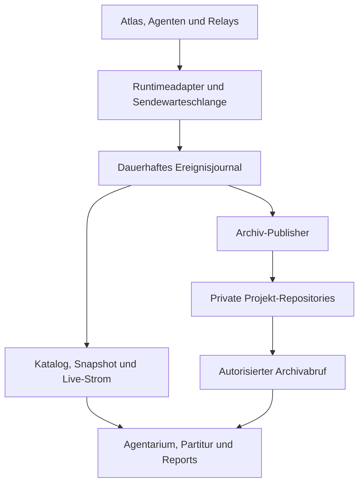

# AG-DATA-001 – Datenerfassung, Live-Anbindung und Projektarchive

Version 1 · 2026-10-16 · Atlas  
Status: KONZEPTENTWURF, nicht aktiviert oder implementiert.  
Repository: pahlborn/agentarium · Ablagebranch: claude/agentarium-visualisierung.  
Auftrag Peter: „arbeitet das konzept bitte aus, findet lücken und optimiert es“ (16.10.2026, 06:22:40 Europe/Berlin).  
Geprüfte Ausgangsbasis: Branchstand f5fbde79fc11ea202dad45856826b16bd68c7971; Konzept des Feldes V2, Blob 5d118e98dcb53d6f6992420b599d151f34a16b1f; AG-REPORT-001 Blob 5e495684ac6b3b4d06d2c9573cabde2c25917205.

Die laufende K1–K3-Schnittstellenkorrektur bleibt ein eigener Auftrag. Dieser Entwurf erklärt Datenherkunft, Speicherung und Zugriff. Er erklärt keine Schnittstellenfassung für abgenommen und erweitert keine Rechte.

## 1. Ergebnis und Empfehlung

Ein gemeinsames Ereignisjournal speist Agentarium, Partitur und die Reports. Die Produktion von Daten hängt nicht davon ab, ob jemand die Visualisierung geöffnet hat.

Empfehlung: Runtimeadapter erfassen tatsächliche fachliche Ereignisse. Eine autorisierte Datenanbindung nimmt sie dauerhaft an und liefert den Live-Strom. Ein begrenzter Publisher archiviert unveränderliche Ereignisblöcke und versionierte Manifeste im Projekt-Repository. Archivabrufe erfolgen über die autorisierte Datenanbindung; GitHub-Zugangsdaten bleiben serverseitig.

GitHub wird nicht für jede Nachricht beschrieben. Ein LLM ist weder Transportserver noch Heartbeat-Erzeuger oder Wiederverbindungsmechanismus.



Dies beschreibt Verantwortungen, keine vorgeschriebene Anzahl von Servern. Journal, API und Publisher können Teile desselben technischen Dienstes sein. Betriebsort und Speicherprodukt sind noch nicht ausgewählt.

## 2. Was schon existiert und was fehlt

| Vorhanden / geprüft | Noch zu bauen oder festzulegen |
|---|---|
| Echte Worklogs unter relay/events, begrenzte Claude/GitHub-Relays | Runtimehooks für alle beteiligten Umgebungen |
| Ereignis-/Snapshot-/Archiv-Vertragsentwürfe und Referenzprüfmittel | Dauerhafter Ingest, Journal, Katalog und Live-Auslieferung |
| AG-REPORT-001: Erfassungsminimum, Lücken, Reports | Reale GitHub-App-/Nutzerberechtigungen, Betrieb, Aufbewahrung |
| Lesender GitHub-Zugriff in dieser Arbeitssitzung | Zugriff einer späteren Agentarium-Anwendung; Sitzungszugriff wird nicht automatisch vererbt |

Es gibt keinen nachgewiesenen permanenten Erfassungsdienst. Automatischer Live-Start, Archivimport und Verbraucherkompatibilität sind NICHT GETESTET.

## 3. Projektregistrierung statt beliebiger Repo-Suche

Einmalig wird ein Projekt mit stabiler project_id registriert. Die ID hängt weder vom Namen noch vom Branch ab.

Registriert werden: team_id, project_id, stabile Repository-Identität, sichtbarer Name, zulässige Quell-Repositories, Archiv-Repository, archive_ref, Wurzelpfad, unterstützte Vertragsfassungen und Zugriffsbereich. Das Archiv-Repository ist im Normalfall das Projekt-Repository. Mehrere Repositories können zu einem Projekt gehören; dann gibt es genau einen benannten Archivanker. Kein Zwang zur Doppelablage.

Eine Umbenennung oder ein Merge erzeugt keine neue Projekt-/Laufidentität. Kopieren eines Repositories registriert nicht automatisch ein neues vertrauenswürdiges Projekt. Unregistrierte Quellen werden nicht selbstständig durchsucht oder freigeschaltet.

V1-Empfehlung: ein dedizierter Archivbranch je registriertem Repository, ausdrücklich in archive_ref hinterlegt. Dies vermeidet Vermischung mit Produktänderungen und reduziert Mergekonflikte. Ein vorhandener anderer Archivbranch ist möglich, wenn bewusst registriert. Nicht implizit main verwenden. Branchanlage und Berechtigungen gehören zur späteren Umsetzung, nicht zu diesem Auftrag.

## 4. Ablage und Gestalt der Dateien

Vorgeschlagene Struktur auf dem registrierten Archivbranch:

| Pfad | Zweck |
|---|---|
| agentarium/project.json | Projektkennung und Auffindbarkeit der veröffentlichten Läufe |
| agentarium/runs/<run_id>/events/<block_id>.json | Ein unveränderlicher, begrenzter Block bestätigter Ereignisse |
| agentarium/runs/<run_id>/revisions/<archive_revision>/manifest.json | Unveränderlicher Archivstand mit Quellen, Abdeckung und Blockverweisen |
| optional: agentarium/runs/<run_id>/snapshots/<snapshot_id>.json | Abgeleiteter Beschleuniger mit Cursor und Reducerfassung; kein Ersatz für Ereignisse |

Kein neues konkurrierendes Fachereignismodell: Die Ereignisse nutzen den jeweils akzeptierten AG-VISUAL-Vertrag. Container-/Indexdateien sind eine zusätzlich zu spezifizierende Verpackung, keine stillschweigende Änderung des fachlichen Schemas.

Ein Ereignisblock enthält:
- Verpackungsversion, block_id, Projekt-/Lauf-/Stromidentität;
- ersten und letzten enthaltenen Transportcursor;
- die originalen bestätigten Ereignisumschläge mit stabiler fachlicher ID;
- Integritätsverweis im Manifest, Dateigröße und Ereignisanzahl.

Ein Manifest enthält:
- archiv_version, Schema- und Reducerfassung, Projekt-/Laufidentität;
- Laufzustand getrennt von Archivzustand;
- geordnete Blockliste mit Pfad, SHA-256, Git-Blob-SHA, Anzahl und Cursorbereich;
- source_ref und konkrete Quellbelege, bekannte Lücken, capture_scope, Zeitachsenqualität;
- Kennzeichnung realer/synthetischer Daten und Erfassungsabdeckung;
- Verweis auf vorangehende Archivrevision und gegebenenfalls Korrekturgrund;
- Kostenfeld mit der bestehenden Vollständigkeitsregel.

Formillustration eines Blockeintrags im Manifest, KEINE reale Evidenz und noch KEIN validierbares Instanzbeispiel:

```json
{
  "path": "events/<block_id>.json",
  "blob_sha": "<Git-Blob-Hash>",
  "sha256": "<SHA-256 der exakten gespeicherten Dateibytes>",
  "first_sequence": 101,
  "last_sequence": 125,
  "event_count": 25
}
```

Der Katalog hält den konkreten Archivcommit und den Manifest-Blob fest. Ein Manifest behauptet nicht seinen eigenen noch gar nicht erzeugten Commit-Hash. Hashes beziehen sich auf exakte Dateibytes, nicht auf beliebig neu serialisiertes JSON.

Dateien werden begrenzt und Verzeichnisse bei Bedarf untergliedert; Verbraucher folgen dem Index, statt rekursiv jedes Repository zu durchsuchen. Die Größen-/Bündelungsgrenzen werden vor einem Pilotlauf als Konfiguration benannt und bei Grenzwerten getestet. Keine ungemessenen Durchsatz- oder Speicherzusagen.

## 5. Live-Start und Ende eines Arbeitslaufs

Atlas beziehungsweise die ausführende Orchestrierung legt bei Beginn eines autorisierten Arbeitsvorgangs run_id fest. Delegierte Rollen übernehmen dieselbe project_id/run_id sowie eigene Aufgaben- und Quellidentitäten. Sie erzeugen nicht für jede Übergabe einen neuen Lauf.

Der Runtimeadapter meldet den tatsächlichen Start und seinen Erfassungsumfang. Live-Daten entstehen automatisch an vorhandenen Hooks, etwa Auftrag, Übergabe, Frage/Antwort, Ergebnis, Review-/QA-Rücklauf und Fehler. Kein menschlicher Startknopf in der Visualisierung ist dafür erforderlich.

Automatisch bedeutet aber: automatisch IN EINER ANGEBUNDENEN RUNTIME. In ChatGPT Work ist kein allgegenwärtiger Hintergrundhook nachgewiesen. Atlas kann hier sichtbare Tool-/Delegationsgrenzen protokollieren und Blöcke ablegen. Das ist bis zu einer echten Ingest-Anbindung eine partielle Erfassung und kein ununterbrochener Live-Strom. Interne Gedanken, versteckte Schritte und unbekannte Tokenzahlen werden nicht behauptet.

Ein verbindlicher Producer-Ausweis pro Sitzung nennt:
- source_id/session_id und platform;
- erfassbare Ereignisarten, bekannte nicht erfasste Bereiche;
- tatsächliches Modell nur mit Laufzeitbeleg;
- letzter dauerhafter Annahmestand und technische Ausfälle.

Arbeitsabschluss wird nur durch ein explizites fachliches Ereignis festgestellt. Ausbleibende Nachrichten oder ein fehlender Endhook bedeuten unbekannt/unterbrochen, nicht abgeschlossen. Ein Neustart einer technischen Verbindung erzeugt keine neue fachliche Ausführung. Ein später bewusst wiederaufgenommener Arbeitsvorgang bekommt entweder einen ausdrücklich revidierten Laufzustand oder einen neuen Lauf mit Vorgängerbezug; keine stille Umdeutung eines veröffentlichten Archivs.

Transportheartbeat beweist allein die Verbindung zur Datenanbindung. Es beweist weder Erreichbarkeit einer Quelle noch aktive Agentenarbeit. Diese drei Zustände bleiben getrennt.

## 6. Haltbarkeit, Zuständigkeit und Bestätigungen

| Zustand | Aussage |
|---|---|
| erfasst / lokal ausstehend | Quelle hat einen Datensatz; dauerhafte Annahme ist noch nicht belegt |
| dauerhaft angenommen | Journal hat Ereignis und Identität nach seinem dokumentierten Speichervertrag bestätigt |
| verfügbar am Cursor | Die View kann den bestätigten Journalstand liefern; keine Behauptung, jeder Browser habe ihn gesehen |
| auf GitHub archiviert | Blöcke und Manifest sind am konkreten Commit veröffentlicht und nachgelesen |

Eine flüchtige Actions-/Cloud-Arbeitsplatte ist keine Garantie gegen Verlust der gesamten Umgebung. Eine Sendewarteschlange darf erst nach dauerhafter Annahme gelöscht werden. Der Annahmenachweis enthält Ereignis-/Batchidentität und bestätigten Stand; ein HTTP-Empfang allein genügt nicht.

Maßgebliche Kopie:
- laufend: dauerhaft bestätigtes Journal;
- konkreter veröffentlichter Archivstand: Manifest und referenzierte Blöcke;
- Snapshots, Katalogcache und Reports: rekonstruierbare Ableitungen.

Das sind verschiedene Stände desselben Journals, keine konkurrierenden Wahrheiten. Abweichungen erzeugen einen Konflikt, kein stilles Zusammenführen. Ein noch nicht archivierter Lauf kann live sichtbar sein, muss aber seinen Archivierungsrückstand zeigen. Kein RPO=0- oder unbegrenztes Haltbarkeitsversprechen.

Ohne verfügbare persistente Annahme gilt capture_degraded. Die Arbeit läuft im vereinbarten Rahmen weiter; Erfassen versucht keine teuren KI-Retryschleifen. Gesicherte Datensätze bleiben nachlieferbar, verlorene beziehungsweise nicht beweisbar gespeicherte Bereiche werden als Lücke ausgewiesen.

## 7. Identität, Parallelität und Reihenfolge

Fachliche Ereignis-IDs sind projektweit eindeutig; Wiederholung verwendet dieselbe ID. Geeigneter Namensraum ist project_id + stabile source_id + source_event_id. Unterschiedliche lokale IDs verschiedener Quellen dürfen nicht kollidieren.

Identische ID mit gleichem Inhalt: einmal fachlich wirksam. Identische ID mit anderem Inhalt: Integritätskonflikt, kein Überschreiben. Batch-ID ist zusätzliche Transporthilfe und ersetzt Ereignisidentität nicht.

Ingest ordnet jedem dauerhaft akzeptierten Datensatz genau einen Stromcursor zu. Quellsequenz, Transportcursor und fachliche Revision sind verschieden. occurred_at bestimmt nicht automatisch Kausalität. Zustandsänderungen benötigen ihre vorhandene Vorgänger-/Revisionsprüfung.

Ein zeitlich später empfangenes Ereignis kann fachlicher Vorgänger sein. Es bleibt in der belegten Empfangshistorie sichtbar; die betroffene Zustandsableitung wird bis zur geregelten Nachlieferung/Neuberechnung gesperrt. Keine nachträgliche Umnummerierung bereits veröffentlichter Transportcursor.

Bei einem ungültigen Übergang bleibt die Eingabe als Diagnose erhalten; der akzeptierte fachliche Zustand ändert sich nicht. Die offene K1–K3-Reparatur ist hierfür eine Voraussetzung, nicht durch dieses Konzept gelöst.

Dedup-Schlüssel und Inhaltsnachweise bleiben mindestens so lange verfügbar wie erneute Zustellung/Import der zugehörigen Ereignisse zulässig ist. Archivimport und erneuter Repoabgleich dürfen alte Ereignisse nicht erneut zählen.

## 8. Archivierung ohne Git-Konflikte und Endlosschleifen

Viele Produzenten sind zulässig, aber nur ein logisch und technisch abgesicherter Publisher veröffentlicht einen Laufstand. Übernahme nach Neustart nutzt eine generation/lease beziehungsweise erwartete Manifestrevision; eine alte Instanz darf danach keinen neuen Stand mehr veröffentlichen.

Ereignisblöcke sind unveränderlich. Eindeutige Blocknamen vermeiden parallele Dateianhänge. Der Publisher sammelt Blöcke und Manifest in einem konsistenten Commit, mit Prüfung des erwarteten Branchstands. Bei zwischenzeitlicher Änderung: neuesten Stand lesen und idempotent erneut abgleichen, nicht fremde Änderungen überschreiben.

Nur ein vollständiger Commit mit nachprüfbaren referenzierten Blöcken wird als veröffentlichter Archivstand in den Katalog übernommen. Ein Uploadabbruch davor ist kein erfolgreiches Archiv.

Terminaler Laufzustand und Erfassungs-/Archivvollständigkeit bleiben unabhängig: Ein abgeschlossener Lauf kann ein ausdrücklich unvollständiges Archiv besitzen. Eine neue Korrektur erzeugt einen neuen Block und eine neue Archivrevision; die alte bleibt reproduzierbar. Replays wählen eine Revision, nicht still die neueste Branchfassung.

Der Publisher wird bei konfigurierten Schwellen, wichtigen Checkpoints und Abschluss aktiv, nicht pro Nachricht. Wiederholte Archivierung ohne Datenänderung erzeugt keinen weiteren Commit. Archivpfade/Branch müssen von implementierenden Workflows so behandelt werden, dass Archivierung nicht erneut Arbeit oder weitere Archivierungsschleifen startet. Bestehende Workflows werden dafür erst im Umsetzungsauftrag geändert.

Git-Historie allein garantiert keine unbegrenzte Verfügbarkeit. Archivbranch, Sicherung und Aufbewahrung müssen vor Betrieb festgelegt werden; keine kurzlebigen Download-URLs als Archividentität speichern.

## 9. Zugriff privater Repositories

Empfehlung: serverseitige GitHub App auf ausdrücklich ausgewählten Repositories mit Contents: read für den Leseadapter. Das separate Publisher-Modul benötigt begrenzte Schreibberechtigung ausschließlich im registrierten Ziel; diese wird der Visualisierung nicht gegeben.

Zusätzlich zur GitHub-App braucht der Nutzer eine autorisierte Anwendungssitzung. Repozugriff des Backends ersetzt keine Nutzerberechtigung. Katalog, Laufstrom, Manifest, Blöcke und Originalartefakte werden pro Anfrage berechtigt; unzugängliche Projekttitel/URLs dürfen nicht im Katalog erscheinen.

V1-Empfehlung für die spätere Pilotumgebung: Frontend und API unter kontrolliertem gleichen Ursprung, sichere Sitzungscookies, native EventSource; andere Betriebsrahmen bleiben über den Datenvertrag darstellbar. Dies ist keine bereits gewählte Hostingumgebung. Der Rahmen steht vor Verbindungsaufbau fest. command bleibt deaktiviert / supported_actions=[].

GitHub-/Anthropic-Schlüssel gehören weder in den Browser noch in Ereignisse, Archivmanifeste, Diagnoselogs oder Offlineexporte. Artefaktlinks sind Referenzen, keine pauschale Weitergabeerlaubnis. Berechtigungsentzug sperrt neue Requests und schließt betroffene Live-Verbindungen; serverseitige Caches bleiben zugriffsgeschützt. Bereits heruntergeladene Dateien können nicht zuverlässig zurückgerufen werden; kein gegenteiliges Versprechen.

Webhooks sind Änderungshinweise: signiert prüfen, nach sicherer Übergabe an die technische Bearbeitung rasch bestätigen, Delivery-ID deduplizieren. Ein fehlender Webhook wird durch zurückhaltenden index-/commitbasierten Abgleich wieder aufgeholt. Nicht alle Arbeitsereignisse existieren in GitHub; Webhooks ersetzen keine Agentenhooks.

Caching nach Commit/Blob, bedingte Abrufe und Backoff reduzieren Requests. Kein Polling sämtlicher Dateien alle paar Sekunden.

## 10. Archivwiedergabe und Altbestände

Der Betrachter wählt Projekt und Lauf; die Anwendung lädt über ihre Datenanbindung den fixierten Archivstand. Der Browser braucht weder einen GitHub-Token noch Kenntnis aller Repoverzeichnisse.

Prüfreihenfolge: Nutzungsrecht → unterstützte Fassung → Manifest/Blockintegrität → Identitäten und Cursorbereiche → fachliche Reduktion. Fehlerhafte Blöcke werden nicht zu einem scheinbar vollständigen Lauf geglättet.

Live und Archiv verwenden denselben fachlichen Reducer und dieselben Datenregeln. Laufende Verbindung plus Snapshot darf genau denselben Zustand am Cursor ergeben wie das Archiv derselben bestätigten Ereignisse. Partitur und Reports erhalten denselben fachlichen Stand, keine eigenen heuristischen Deutungen.

Archivabspielen erzeugt keine Agentenläufe, GitHub-Aktionen oder Befehle. Zulässig bleiben die ausdrücklich angeforderten Lesezugriffe zum Laden der Daten; Nebenwirkungsfreiheit meint keine schreibenden oder arbeitsauslösenden Aktionen, nicht ein generelles Verbot des Datenabrufs.

Alte relay/events-Dateien bleiben unverändert. Ein versionierter Adapter ergänzt belegten Projekt-/Laufkontext, bewahrt Quellbelege und markiert rückwirkende Rekonstruktion. Fehlende Zeiten, Owner oder Done-Nachweise werden nicht erfunden. Zeitachse partial/none ergibt sichtbare Schrittfolge; Datenvollständigkeit ist etwas anderes als vollständige Zeitstempel.

Ein autorisierter Offlineexport kann dieselbe geprüfte Archivrevision enthalten. Er ist eine separate Datenweitergabe mit ausdrücklich ausgewähltem Umfang und Empfängerrechten, keine automatische öffentliche Veröffentlichung.

## 11. Erfassungsumfang, Aufwand und Kosten

Standard sind Metadaten und eine kurze sachliche Ereigniszeile. Vollständige Prompts, Antworten, private Rechercheseiten und Tooltranskripte gehören nicht automatisch ins Journal. Ein Beleglink samt genauer Version genügt häufig. Rohinhalte und beobachtbare Kommunikation sind nicht gleichzusetzen.

Erfassen an ohnehin vorhandenen Übergaben, Ergebnissen und Fehlern; keine Frame-/Maus-/Tokenereignisse. Recherche wird als fachliches Quellenpaket oder relevante Rückfrage erfasst, nicht jeder Seitenabruf einzeln. Reale Rückfragen/Einwände werden nicht für ein ruhiges Bild entfernt.

Schutz sensibler Inhalte erfolgt vor dauerhafter Speicherung; auch ein Titel kann vertrauliche Informationen enthalten. Aufbewahrung wird pro Schicht festgelegt: Outbox bis Bestätigung, Journal bis verifizierter Archivierung plus vereinbartem Recoveryfenster, Archiv nach Projektvorgabe, Export nach ausdrücklichem Umfang. Versehentlich archivierte Geheimnisse brauchen einen separaten Bereinigungs- und gegebenenfalls Schlüsselwiderrufsprozess; Unveränderlichkeit ist keine Pflicht zur ewigen Speicherung vertraulicher Fehler.

Kein separater LLM-Aufruf für Logtransport, Validierung, Heartbeats, Archivierung oder Reports. Technischer Betrieb kann dennoch Hosting-, Speicher- und API-Aufwand verursachen. Dieser ist vor Aktivierung zu benennen; derzeit keine belastbare Kostenzahl.

Kostenfeld bleibt sichtbar und zeigt ohne vollständigen Nachweis ausschließlich „Kosten nicht vollständig ermittelbar.“ Vollständige Ereigniserfassung beweist keine vollständige Kostenmessung.

## 12. Gefundene Lücken und eingearbeitete Optimierungen

| Lücke | Präzisierung / Optimierung |
|---|---|
| Chat startet vermeintlich automatisch dauerhaften Liveprozess | Runtimeanbindung und ihre Coverage ausdrücklich nachweisen; bis dahin partielle Dateierfassung |
| Lokale Datei wird als verlustsicher dargestellt | dauerhafte Annahme separat bestätigen; Verlust der Umgebung berücksichtigen |
| Journal, Git und Cache könnten auseinanderlaufen | Autorität pro Phase, unveränderliche Archivrevision, kein stilles Mischen |
| Viele Quellen schreiben gleichzeitig dieselbe Datei | immutable Blöcke, ein abgesicherter Publisher, Manifestrevision/Branchprüfung |
| GitHub als Nachrichtenbus | Livejournal plus gebündelte Checkpoints, keine Commits je Nachricht |
| Repo-/Branchname als Projekt-ID | stabile Identität, registrierter Archivanker, exakte Commit-/Blobbezüge |
| Private Reporechte werden mit Nutzerrechten verwechselt | Backendcredential und Nutzerfreigabe getrennt; Katalog mitfiltern |
| Fehlendes Endsignal wird als Erfolg interpretiert | Laufzustand unbekannt/unterbrochen; kein automatisches Done |
| Zeit-, Daten- und Kostenabdeckung werden vermischt | drei separate Aussagen, unbekannte Werte erhalten |
| Permanenter Gesamtmitschnitt erhöht Aufwand | kurze fachliche Metadaten, Quellenverweise, deterministische Auswertung |

## 13. Spätere begrenzte Abnahme

Alle folgenden Szenarien sind NOT_TESTED, da keine Implementierung vorliegt:

T1: Crash vor/nach dauerhafter Annahme, unterbrochene Quittung, erneutes Senden. Kein Verlust nach vereinbarter Speichergrenze; keine vorgetäuschte Bestätigung davor.
T2: Identische Doppelsendung wirkt einmal; gleiche ID mit anderem Inhalt erzeugt Konflikt.
T3: Zwei Quellen/Projekte und verspäteter Vorgänger bleiben isoliert; ungültige Übergänge wirken nicht.
T4: Fehlender Hook, Absturz ohne Ende und nicht angebundene Runtime erscheinen als Coverage-Lücken.
T5: Offlinepuffer, volle Kapazität und Teilzeiten ergeben sichtbare eingeschränkte Erfassung, keine erfundene Dauer.
T6: Snapshot plus Tail, Duplikat und Lücke ergeben nach geordneter Recovery denselben Zustand wie Vollrekonstruktion.
T7: Nichtberechtigte Projekte, entzogene Sitzung und erratene IDs liefern keine Daten/Metadaten; keine Providersecrets im Browser.
T8: Abbruch/paralleler Publisher, neue Archivrevision und Replay: alte Revision reproduzierbar, unvollständige Veröffentlichung nicht als vollständig, keine Arbeitsauslösung beim Abspielen.

Vor einem Pilot sind Speicherbestätigung, Queuekapazität/Überlaufverhalten, Batchgrenzen, Retry-/Recoveryfenster, Aufbewahrung und Berechtigungsentzug mit konkreten Konfigurationswerten festzuhalten. Tests prüfen diese Werte und Grenzfälle. Performance-/Kostenmessung erfolgt im ohnehin erforderlichen kleinen Integrationslauf, keine separate teure Kampagne.

## 14. Einführung und offene Entscheidungen

1. Zuerst bestehende K1–K3-Vertragsfehler schließen. Dieses Konzept ist kein Ersatz dafür.
2. Konzept mit späterem akzeptiertem Fachvertrag in einem kleinen Ablage-/Adaptervertrag verbinden.
3. Vorhandenen Betriebsort und dauerhafte Speicherung ermitteln. Falls neue Infrastruktur erforderlich ist, konkrete Varianten mit laufendem Aufwand Peter vorlegen.
4. Pilot nur mit Agentarium als einem registrierten Repository, einem echten Lauf und bewusst erfasster Coverage.
5. Sentinel prüft T1–T8 im begrenzten Pilot; danach derselbe belegte Lauf in Agentarium und Partitur.
6. Weitere Repositories nur nach bewusster Registrierung anschließen, nicht pauschal umstellen.

Materiell offen: Betriebsort, dauerhafter Speicher/Sicherung, effektive App-/Publisherrechte und Archivbranch, Konfigurationsgrenzen/Aufbewahrung. Empfohlenes gleiches Origin ist ein Konzeptvorschlag, keine aktivierte Architekturentscheidung. supported_actions bleibt [].

Keine Änderung an anderen Repositories, Workflows, GitHub-App-Installationen, Infrastruktur oder Berechtigungen wurde ausgeführt. Keine Claude-Sitzung und kein kostenpflichtiger API-Test wurde gestartet.

## 15. Echte Teambeiträge und Grenzen

- Scout /root/scout_data_access_concept, AG-DATA-001-RESEARCH V1, RKA_READY: offizielle GitHub-Quellen, private Apprechte, commitgebundene Archive, Webhook-/Rate-/Actionsgrenzen.
- Argus /root/argus_data_access_concept, AG-DATA-001-CONCEPT-REVIEW V1, RA_REVIEW / PASS_WITH_NOTES für die übermittelte Skizze: sechs Lücken A1–A6 zu Haltbarkeit, Autorität, Publisher, Katalog, Rechten und Aufbewahrung.
- Sentinel /root/sentinel_data_capture_concept, AG-DATA-001-TESTABILITY V1, TESTABILITY_REVIEW / NOT_TESTED: acht Szenarien T1–T8 und vier Vertragslücken.
- Atlas: aktuelle Repo-/Konzeptbasis gelesen, offizielle Quellen selbst geöffnet, Beiträge in diese Fassung eingearbeitet.

Die Endfassung wurde nach der Konsolidierung nicht erneut unabhängig geprüft. Die Rollen prüfen ein Konzept, keine laufende Datenanbindung. Root-AGENTS.md lieferte 404; daraus wird keine sichere Abwesenheit aller Projektregeln abgeleitet.

## 16. Quellenregister

Offizielle GitHub-Dokumentation, Scout und Atlas am 16.10.2026 gelesen. Die vorgeschlagene Architektur ist eine Ableitung, keine Empfehlung von GitHub und kein Nachweis einer existierenden Agentarium-Anbindung.

S1: https://docs.github.com/en/apps/creating-github-apps/authenticating-with-a-github-app/generating-an-installation-access-token-for-a-github-app
Installationsberechtigungen lassen sich auf ausgewählte Repositories und Rechte beschränken; Installationstoken laufen nach einer Stunde ab.

S2: https://docs.github.com/en/rest/repos/contents
Contents-Zugriff unterstützt konkrete Commitreferenzen und benötigt für private Inhalte Contents: read. Download-URLs sind flüchtig; Verzeichnis-/Dateigrenzen begründen begrenzte Blöcke und Indizes.

S3: https://docs.github.com/en/webhooks/using-webhooks/best-practices-for-using-webhooks
Signatur, rasche Antwort, asynchrone Verarbeitung und Delivery-ID.

S4: https://docs.github.com/en/webhooks/using-webhooks/handling-failed-webhook-deliveries
Fehlgeschlagene Zustellungen werden nicht automatisch erneut gesendet; eigener Abgleich erforderlich.

S5: https://docs.github.com/en/rest/using-the-rest-api/best-practices-for-using-the-rest-api
Webhooks, bedingte Requests, Rate-Limit-Behandlung und Backoff.

S6: https://docs.github.com/en/actions/reference/limits
GitHub-gehostete Jobs besitzen eine begrenzte Laufzeit; kein dauerhafter SSE-Betrieb auf Basis eines endlosen Actionsjobs.

Vorhandene Projektquellen: concepts/AG-VISUAL-005-agentarium-konzept-v2.md und governance/AG-REPORT-001-minimal-worklog-v1.md, oben exakt gebunden.
