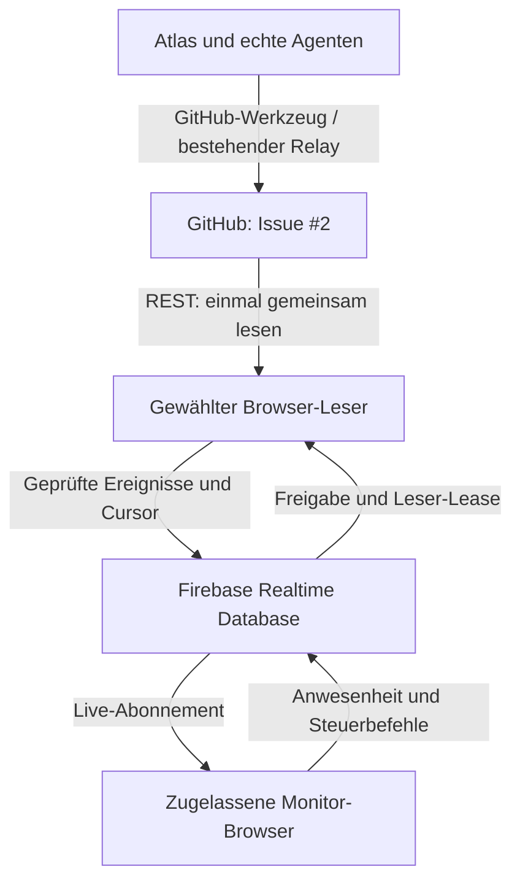

# AG-FIREBASE-CONCEPT-001 — Agentarium ohne eigenen Host
Version 0.1 · 25.10.2026 · Atlas-Konzept und Spezifikationsentwurf, **nicht freigegeben**.
Baseline: `a4e10c6e0f4c98fa160112e20a1ba06d81b76b63`. Keine Einrichtung, Implementierung, Migration oder Veröffentlichung beauftragt.

## 1. Auftrag, Ziel und Grenzen
Peter verlangt erst Gesamtkonzept/Spezifikation mit Komponenten, Datenflüssen und Schnittstellen, anschließend Review, danach Epics und User Stories. Noch keine Umsetzung und kein Backlog aus ungeprüften Annahmen.
Ziel: aktive Monitore geräteübergreifend erkennen, ihre Anzahl begrenzen, bestimmte Monitore deaktivieren und unnötige GitHub-Abfragen reduzieren.
Kein selbst betriebener Host, kein zusätzlicher eigener Server. Firebase als verwalteter Dienst ist ein Kandidat; Peter besitzt bisher nur einen Google-Account, kein eingerichtetes Firebase-Projekt. Vorgabe für den Entwurf: Spark ohne Billing-Verknüpfung, keine Cloud Functions, kein Blaze.
GitHub bleibt Code-/Arbeitsbelegquelle. Die bestehende Bühne und Ereignissemantik werden wiederverwendet; keine neue Visualisierung.

## 2. Verifizierter Ist-Stand
- GitHub-Live liest Issue #2 mit 100 Kommentaren je Seite. Grundtakt 2 Sekunden nach Abschluss des Abrufs; GitHub-Poll-Interval, Fehlerwartezeiten und Hintergrundpause können ihn verlängern.
- ETags/304 werden benutzt; authentifizierte 304 verbrauchen laut GitHub kein primäres Kontingent. HTTP-Anzahl und belastetes Kontingent sind verschiedene Messgrößen.
- Jeder Browser hat eigene Verbindung und Zähler. Es gibt im geprüften Adapter keine gemeinsame Monitorregistrierung.
- `window.__agGithubBruecke`, `window.__agStrom`, `window.__agWiederherstellen` sind vorhandene Integrationspunkte; ihre vollständigen Verträge sind vor einer Implementierung durch Lot zu bestätigen.
- Historie wird als Zustand wiederhergestellt, nicht als vergangener Ballflug nachgespielt.
- Ein gespeicherter Kommentar oder Queuezähler ist kein Nachweis gezeichneter Bälle.
Quellen: `pilot/github-live/github-live.js` an obiger Baseline; nur betroffene Stellen gelesen. Livegerät, Token, aktuelle Browserfassung und Nutzungszähler nicht eingesehen.

## 3. Varianten und Entscheidung
| Variante | Monitorsteuerung | GitHub-Abfragen | Grenze |
|---|---|---|---|
| A: Firebase nur für Verwaltung | Gemeinsame Presence/Freigaben; jedes zugelassene Gerät liest GitHub | Weiter je aktivem Gerät | Kleinerer Eingriff, keine gemeinsame Ereignisverteilung |
| B: Firebase zusätzlich als Verteiler | Wie A; ein gewählter Browser liest GitHub und schreibt einen gemeinsamen Ereignispuffer | Ein Leser je vereinbartem Quellstrom, weitere Monitore beobachten Firebase | Abhängig von einem laufenden, berechtigten Browser |
| C: Direktmeldungen aller Agenten an Firebase | Produzenten schreiben selbst; GitHub zusätzlich als Beleg | Weniger GitHub-Polling möglich | Erfordert neue verifizierte Schreib-/Authwege für jede Agentenplattform; aktuell nicht gegeben |
**Arbeitsvorschlag, keine Architekturfreigabe:** B als Zielbild, A als Vergleich. C nicht stillschweigend voraussetzen.
Firebase ist kein GitHub-Webhook-Server und ruft nicht von selbst Issue #2 ab. Ohne eigenen Host muss die Übertragung durch einen vorhandenen Browser oder einen eigens autorisierten vorhandenen Ausführungsweg erfolgen.

## 4. Komponenten und Architekturskizze

Der Leser ist eine Funktion eines Monitor-Browsers, kein neuer Rechner/Dienst. Er darf GitHub nur lesen, wenn Token, Freigabe und gültige Leser-Lease vorliegen. iPad und PC bleiben normale Monitore. Authentifizierung und Rules schützen sämtliche Firebase-Zugriffe.

| Komponente | Verantwortung | Kein Auftrag an diese Komponente |
|---|---|---|
| Bestehende Produzenten | Echte Übergaben/Zustände nach Issue #2 melden | Keine erfundenen Rollenstarts; kein automatischer Firebase-Zugriff durch vorhandenen GitHub-Connector |
| GitHub-Journal | Nachvollziehbare Originalbelege und Wiederherstellungsquelle | Kein Presence-/Heartbeat-Speicher |
| Firebase Authentication | Betreiber und zugelassene Geräte/Browsersitzungen zuordnen | Keine Übernahme von GitHub-Tokens |
| Firebase Rules | Zugriffe, Felder, Freigaben und Schreibberechtigungen serverseitig begrenzen | Keine Hintergrundjobs |
| Registrierungs-/Steuermodell | Namen, Sitzungen, letzter Kontakt, Freigaben, Höchstzahl | Online allein bedeutet nicht sichtbar oder tatsächlich abfragend |
| Leserkoordination | Zeitlich begrenzte Lease, Generation und geregelte Übernahme | Keine dauerhafte Browserausführung zusichern |
| GitHub-Leser | Paginiert lesen, Quoten achten, prüfen, deduplizieren, veröffentlichen | Keine Vollhistorie pro Aktualisierung |
| Ereignispuffer/Projektion | Begrenzte aktuelle Daten und Fortsetzungscursor | Kein zweites unbegrenztes Archiv |
| Monitoradapter/Bühne | Zustand und neue echte Ereignisse darstellen; Diagnose anzeigen | Kein automatisches Nachspielen alter Bälle |

## 5. Datenflüsse und Schnittstellen
| ID | Von → Nach | Schnittstelle / Inhalt |
|---|---|---|
| IF-01 | Agent/Atlas → GitHub | Bestehender `agentarium.github-event.v1`-Kommentar; ein Ereignis je Kommentar |
| IF-02 | Leser → GitHub | HTTPS-REST, vorhandene Authentifizierung, ETag und Pagination; Wiederaufnahme am gespeicherten Cursor |
| IF-03 | Browser → Firebase Auth | Geprüfte Anmeldung/Zuordnung; Verfahren noch festzulegen |
| IF-04 | Monitor ↔ Firebase | Presence, Konfiguration/Freigaben, zeitgestempelte Zustandswechsel; gezielte SDK-Listener |
| IF-05 | Kandidaten ↔ Firebase | Transaktionale Leser-Lease mit Ablauf und Generation; keine Wahl nur aus Presence |
| IF-06 | Leser → Firebase | Validierte normalisierte Ereignisse plus Originalreferenz, Schema-/Projekt-/Lauf-ID, Cursor und Leasegeneration |
| IF-07 | Firebase → Monitoradapter | Initialer Snapshot plus neue Ereignisse; Deduplizierung und klare Live-/Wiederherstellungsgrenze |
| IF-08 | Adapter → vorhandene Bühne | Bestehende Verträge von Lot bestätigen; Rendernachweis getrennt von Empfang |

Normaler Ablauf: Anmeldung → Aufnahme/Freigabe → Listener → Leserwahl → neuer GitHub-Kommentar → validierter Eintrag im Puffer → alle zugelassenen Monitore erhalten dasselbe Ereignis.
Beim Verbinden zuerst Zustand aufbauen, dann Livegrenze setzen. Wiederverbindungen dürfen keine neuen Flüge für bereits abgeschlossene Historie vortäuschen.
Archibald/Forge/Cadence bleiben echte Claude-Rollen; Änderungen am Transport dürfen deren Identität nicht mit Host/Publisher verwechseln.

## 6. Logisches Datenmodell — noch kein Firebase-Regelsatz
| Objekt | Wesentliche Angaben |
|---|---|
| Monitor | stabile Gerätekennung, Anzeigename, authentifizierter Besitzer |
| Sitzung | neue Instanzkennung, Gerät, Verbindung/Sichtbarkeit, angefordert/zugelassen/gesperrt, Serverzeit des letzten Kontakts |
| Steuerung | maximale aktive Sitzungen, gezielte Freigabe/Sperre, Konfigurationsversion, Ändernder |
| Leser-Lease | Instanzkennung, Generation, Ablaufzeit; nur genau ein gültiger Schreiber je Quellstrom |
| Ereignis | Originalkommentar-ID/URL, Ereignis-ID, Projekt/Lauf/Aufgabe, Melder/Akteur, Nutzdaten, Eingangszeit, Generation |
| Fortsetzung | Quellcursor, Snapshot-/Schemasversion, letzte erfolgreiche Übernahme |
| Diagnose | Anfragen/200/304/Fehler, letzter Quotenstand/Reset, Firebase-Verbindung, letzter gelieferter Stand |
| Präsenzverlauf | begrenzte Statuswechsel für „jetzt“/„letzte fünf Minuten“; keine permanente Speicherung jedes Herzschlags |

GitHub-Token bleibt ausschließlich im berechtigten Browser nach bestehender Tokenregel. Kein Token, Service-Account-Schlüssel oder Admin-Zugang in Firebase, Ereignissen, Repository oder anderen Monitoren.

## 7. Regeln für Aktivierung und Ausfälle
- **Begriffe:** registriert, Firebase-verbunden, sichtbar, zum Livebetrieb zugelassen und tatsächlich lesend sind getrennte Zustände. „Aktiv“ muss vor Umsetzung eindeutig festgelegt werden.
- Höchstzahl wird beim Zulassen konkurrierender Sitzungen atomar durchgesetzt, nicht durch Zählen einer verzögerten Presence-Liste. Gerät und Tab nicht gleichsetzen.
- Eine gezielte Sperre beendet das eigene GitHub-Polling und den Live-Datenbezug; vorhandenes Bild bleibt mit Status sichtbar. „Sperre erteilt“, „bestätigt“ und „Freigabe abgelaufen“ unterscheiden. Kein fremdes Browserfenster schließen.
- Lease und Aktivierungsfreigabe laufen ohne erneuerte Bestätigung ab. Veraltete Leser dürfen nicht mehr veröffentlichen; verspätete Ergebnisse werden anhand der Generation abgewiesen. Bereits fliegende HTTP-Anfragen können beim Wechsel kurz überlappen; kein falsches Null-Überlappungsversprechen.
- Suspendierter iPad-Browser kann weder GitHub lesen noch die eigene UI aktualisieren. Ein anderer ausführbarer berechtigter Browser darf übernehmen. Ohne solchen Browser: Quellenstand veraltet, keine behauptete Liveaktivität.
- Bei Firebase-Ausfall keine automatische Rückkehr aller Monitore zu eigenem GitHub-Polling. Bei GitHub-Limit bis zur vorgegebenen Freigabe warten; UI zeigt letzten Stand und Ursache.
- Mindestens-einmal-Verarbeitung mit Deduplizierung, keine ungeprüfte Genau-einmal-Zusage. Atomare Veröffentlichung von Cursor und angenommenem Datenstand sowie Umgang mit Kommentaränderungen spezifizieren.
- Zulassung/Lease benötigen serverseitig prüfbare Identität, Zeit und Regeln. Eine zufällige Instanzkennung allein ist keine Berechtigung. Dasselbe Google-Konto auf mehreren Geräten unterscheidet keine Sitzungen sicher.
- Anmeldung, Rollenmodell und Gerätefreigabe sind vor Produktionsfreigabe zu lösen. Anonyme Anmeldung darf keinesfalls automatisch Lese-/Schreibrechte auf Projektdaten gewähren. Nicht bloß auf kooperativen Browsercode vertrauen.

## 8. Anforderungen und entscheidende Nachweise — Entwurf, keine Stories
| ID | Anforderung | Entscheidender späterer Nachweis |
|---|---|---|
| REQ-01 | Keine selbst betriebene Laufzeit, kein Blaze/Billing | Konfigurations-/Abrechnungsprüfung des tatsächlichen Projekts |
| REQ-02 | Instanzen und Status getrennt anzeigen, Verlauf letzte fünf Minuten | Zwei Geräte plus mehrere Tabs, Statuswechsel/Suspendierung gegen protokollierte Beobachtungen |
| REQ-03 | Höchstzahl bei Gleichzeitigkeit einhalten | Gleichzeitige Zulassungsversuche; keine unzulässigen aktiven Freigaben |
| REQ-04 | Bestimmte Instanz deaktivierbar | Bestätigung oder gemessener Ablauf der Freigabe; keine weiteren erlaubten Abrufe/Schreibvorgänge danach |
| REQ-05 | In Variante B ein gültiger Leser pro Quelle, geregelter Wechsel | Abbruch, Freeze und verspätete Rückkehr des alten Lesers; stale writes abgewiesen |
| REQ-06 | Echte Ereignisse auf zwei Geräten, gleiche Originalbelege | Echter Auftragskommentar bis tatsächlich gezeichneter Übergabe auf iPad und PC; keine Attrappe |
| REQ-07 | Lücken/Wiederverbindung ohne alte Ballflüge | Unterbrechung, Snapshot und neue Livegrenze; Reihenfolge/Duplikate/Lücken messbar |
| REQ-08 | Zugriff serverseitig geschützt | Nicht zugelassenes Gerät kann Daten nicht lesen, Einspeisung/Steuerung nicht ändern; kein Tokenabfluss |
| REQ-09 | GitHub-/Firebase-Nutzung belegbar reduzieren | HTTP- und quotenbelastete Anfragen sowie Firebase-Downloads getrennt, vergleichbare Sitzung messen |
| REQ-10 | Ausfälle ehrlich sichtbar | Rate-Limit, Null-Leser, Firebase-Quota und Netzunterbrechung führen zu benanntem veraltet/unterbrochen statt Fake-Live |

Zeitgrenzen, maximal aktive Geräte, Aufbewahrung und konkrete Nutzungsobergrenzen sind offene Parameter, keine geratenen Sollwerte. Keine pauschale Sekunden-/Kostenersparnis zusagen.

## 9. Betrieb und Kosten ohne eigenen Host
Firebase ist zusätzliche verwaltete Infrastruktur, aber kein von Peter betriebener Host. Spark erfordert keine Zahlungsdaten; kein Billing-Konto verknüpfen. Laut aktueller offizieller Preisseite gelten für Realtime Database Spark 100 gleichzeitige Verbindungen, 1GB Speicherung und 10GB Downloads/Monat; das sind technische Tarifgrenzen, keine empfohlene Anzahl Monitore.
Datenmodell, Listenerumfang, Wiederverbindungen und Aufbewahrung bestimmen den Verbrauch. Spark-Grenzen bedeuten mögliche Dienstausfälle, keinen unbemerkten unbegrenzten Mehrverbrauch; keine automatischen Tarifwechsel.
Cloud Functions/Blaze sind nicht Bestandteil des Vorschlags. GitHub und Firebase können unabhängig ausfallen. HTTP-Anfragenzahl und primäres GitHub-Kontingent getrennt auswerten.

## 10. Offene Entscheidungen und fachliche Übergabe
| Punkt | Zuständigkeit / noch zu liefern |
|---|---|
| A oder B; akzeptable Unterbrechung ohne laufenden Leser | Peter entscheidet nach technischer Bewertung; Lot prüft Machbarkeit zuerst |
| Geräte-/Sitzungsidentität, Rechte, Zulassung, Lease-/Cursoratomizität | Lot als technischer Eigentümer; Archibald spezifiziert die abgestimmte Variante |
| Obergrenze, Aktualität, Ablaufzeiten, Aufbewahrung, Firebase-Region | Durch Anforderungen/Nutzungsziel begründen und mit Peter entscheiden |
| Einbindung in bestehende Bühne und Grenzen der Browserausführung | Lot, mit engem Lesebudget statt Vollkontext |
| Vollständige versionsgebundene Spezifikation | Archibald; hier liegt nur Atlas' Entwurf vor |
| Unabhängiger Review und Testbarkeit | Argus für Konzept; Sentinel später für die konkrete Spezifikations-/Testlücke |

**Technischer Kurzauftrag für Lot — vorbereitet, nicht kostenpflichtig aktiviert:** Nur Abschnitte3–8 dieses Dokuments und die bestehenden Adapterverträge gezielt lesen. Eine Rückgabe mit kritischer Annahme, kleinster hostloser Route, Alternative und konkretem Integrationsblocker; keine Implementierung, kein Voll-PR-Lesen. Maximal400Wörter. Vor einem bezahlten Lauf konkretes Budget/Route klären.
**Archibald-Auftrag — vorbereitet, nicht aktiviert:** Nach Lots Rückgabe die entschiedene Variante in testbare Schnittstellen/Zustands-/Fehlerregeln präzisieren. Keine neue Architektur neben Lots Bewertung, keine Implementation, kein Backlog vor Review.

## 11. Phasen und Abschlussgrenze
1. Konzeptentwurf mit Fakten/Alternativen — dieses Dokument.
2. Technische Eigentümerbewertung und vollständige Spezifikation — noch ausstehend.
3. Unabhängiger Review der exakten Version; offene wesentliche Einwände bearbeiten.
4. Erst anschließend Epics/User Stories mit IDs, Beziehungen, Akzeptanzkriterien und Testreferenzen ableiten und schätzen.
5. Umsetzung ausschließlich nach den dann erforderlichen Freigaben. Ein späterer Machbarkeitsnachweis ist jetzt nur beschrieben, nicht gestartet.

Kein Firebase-Projekt angelegt, kein SDK eingebaut, keine Rules geändert, kein Token angefordert und kein kostenpflichtiger Claude-Lauf gestartet. Die Budgetfreigabe für Ballbrause gilt nicht für diese Konzeptphase.

## 12. Quellen und Provenienz
- Ist-Code: https://github.com/pahlborn/agentarium/blob/a4e10c6e0f4c98fa160112e20a1ba06d81b76b63/pilot/github-live/github-live.js
- Firebase Browserzugriff/Transaktionen: https://firebase.google.com/docs/database/web/read-and-write
- Presence/Serverzeit/onDisconnect: https://firebase.google.com/docs/database/web/offline-capabilities
- Authentifizierung/Rules: https://firebase.google.com/docs/database/security
- Aktuelle Spark-Preise: https://firebase.google.com/pricing
- Spark/Blaze/Billing: https://firebase.google.com/docs/projects/billing/firebase-pricing-plans
- Browser-Freeze/Discard: https://developer.chrome.com/docs/web-platform/page-lifecycle-api (allgemeine Browsergrenze; kein gemessener Safari-Timeout)
- GitHub ETag/304: https://docs.github.com/en/rest/using-the-rest-api/best-practices-for-using-the-rest-api

Scout `/root/scout_firebase_concept` hat Firebase-Fakten und Grenzen unabhängig recherchiert. Atlas hat den Ist-Code geprüft und diesen Entwurf verfasst. Keine Lot-/Archibald-Mitwirkung behauptet. Das Dokument ist weder technische Freigabe noch getestete Umsetzung.
