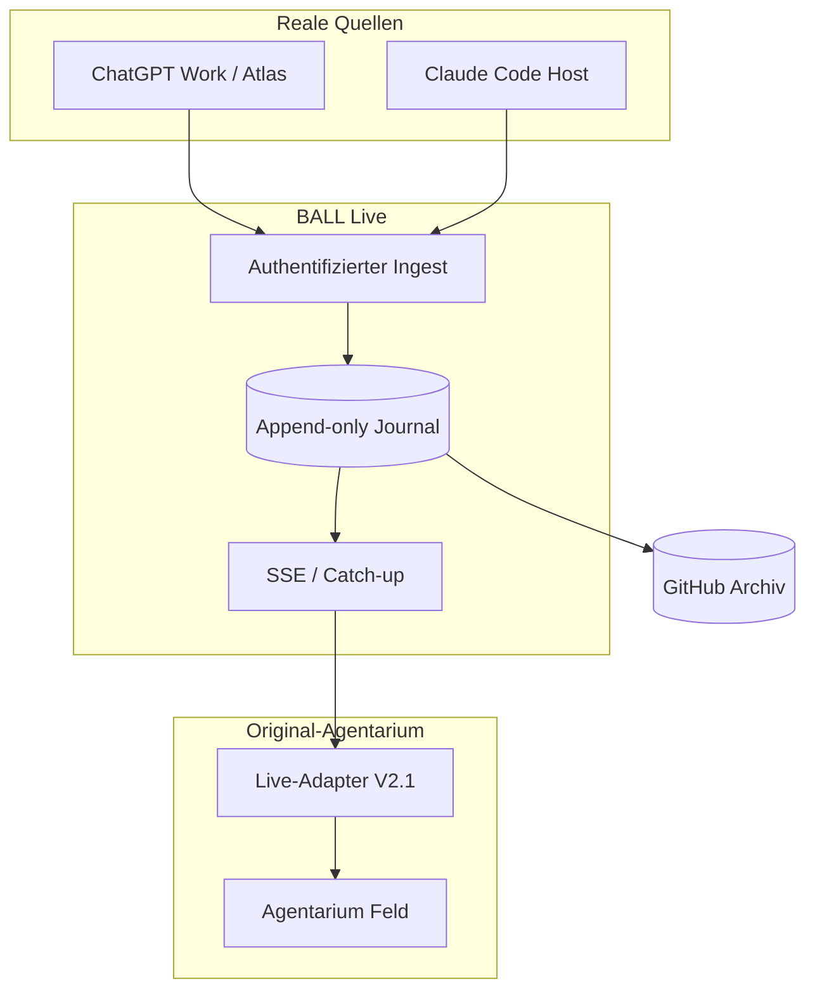
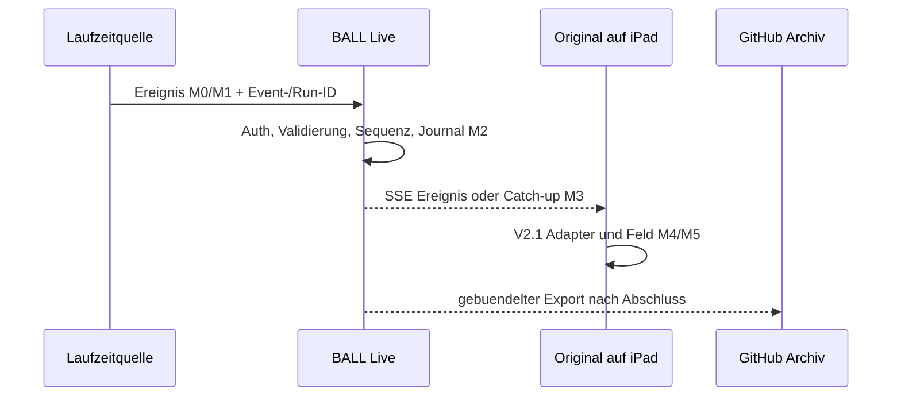

# AG-BALL-LIVE-001 — Konzept- und Machbarkeitsstudie V1

Status: DRAFT bis Forge, Archibald, Argus und Sentinel gegen exakt diese Fassung geprueft haben.  
Datum: 2026-10-17. Owner: Atlas.  
Produktbaseline: Original-Agentarium `feld/`, Kandidat `d111b062770e32dbef0f9bb618a4923d88ff20be`.  
Arbeitsbranch: `agent/ball-live-concept-20261017`.

## 1. Ziel in Kundensprache

Peter oeffnet Agentarium auf dem iPad und sieht tatsaechliche Teamarbeit kurz nach ihrem Geschehen, obwohl die Arbeit unabhaengig vom Monitor gestartet wurde. Er erkennt:

- wer einen Auftrag angenommen, weitergegeben, bearbeitet, hinterfragt oder abgeschlossen hat;
- ob die Anzeige aktuell verbunden, nachholend oder veraltet ist;
- ob ein Agent nachweislich aktiv, bereit, blockiert, beendet oder derzeit nicht beurteilbar ist;
- aus welcher Plattform und welchem Run eine Aussage stammt und ob sie technisch beobachtet, vom Agenten gemeldet oder abgeleitet wurde;
- spaeter denselben Lauf als gekennzeichnetes Archiv, ohne alte Ereignisse als neue Livearbeit auszugeben.

Das Produkt zeigt keine Gedanken, keine erfundene Aktivitaet und keinen Fortschrittsprozentsatz ohne belastbaren Bezugsumfang.

## 2. Architektur — vollstaendiges Zielbild

**Wesentliche Grenze:** BALL Live ist keine zusaetzliche KI-Rolle. Es ist der verlaessliche Transport- und Wahrheitskern. Agenten oder Runtime-Adapter erzeugen Ereignisse; der Dienst validiert, speichert und verteilt sie. Ein optionaler KI-Beobachter darf spaeter zusammenfassen, aber niemals Transportwahrheit ersetzen.

### Von Forge im Originalcode verifizierte Vorbedingungen

1. Die 17 vorhandenen Ereignisarten bilden keinen neutralen Zwischenstand ab: mehrere Arten beenden die Arbeit des Absenders, andere blockieren oder loesen Blocker. Fuer „arbeitet weiter“ ist eine neue, seiteneffektfreie Art wie `progress` notwendig.
2. `window.__agEreignis` dedupliziert nicht, ordnet nicht und bewahrt mehrere Provenienz-/Runfelder nicht. Der Empfangsadapter muss dies vor dem Hook leisten; eine manuelle Injektion waere kein tragfaehiger Produktweg.
3. Ereignistitel gelangen im Livepfad an Stellen unescaped in `innerHTML`. Vor externem Ingest ist der Wechsel zu sicherer Textbehandlung Pflicht, sonst entsteht ein XSS-Pfad.
4. Das Original besitzt bereits `__agStrom` mit getrenntem Kanal-Lebenszeichen und Veraltet-Zustand. Dieser Baustein soll genutzt, nicht neu erfunden werden. Heartbeat bleibt Transportgesundheit und beweist keine Agentenarbeit.

### Komponenten

| Komponente | Verantwortung | Darf nicht behaupten |
|---|---|---|
| Quellenadapter Work | belegte Orchestrierungsaktionen und explizite Checkpoints mit Herkunft erzeugen | vollstaendige passive Work-Telemetrie ohne Beleg |
| Quellenadapter Claude | Hooks/Stream des kontrollierten Claude-Hosts waehrend des Runs erfassen | innere Aktivitaet nur aus Jobstatus ableiten |
| Ingest | Produzent authentifizieren, Schema/Projekt/Run pruefen, Event-ID deduplizieren | Fachfortschritt aus Empfang ableiten |
| Journal | angenommene Ereignisse append-only mit Sequenz, Original-/Empfangszeit und Herkunft halten | unbekannte Zeiten oder fehlende Events erfinden |
| Stream | Snapshot/Cursor und neue Ereignisse read-only an Browser liefern; Reconnect/Catch-up | Speicherung allein durch SSE versprechen |
| Adapter im Original | Vertragsereignisse an `__agLauf` / `__agEreignis` uebergeben; Ablehnungen zeigen | Ersatzoberflaeche oder Demo-Run starten |
| Archivexport | abgeschlossenen Journal-Ausschnitt plus Manifest/Hashes nach GitHub schreiben | Archiv als Live oder lueckenlos markieren, wenn Luecken bestehen |

## 3. Messbarer Datenfluss

M0 ist die tatsaechliche Laufzeitaktivitaet, M1 deren Erfassung, M2 durable Annahme, M3 Browserempfang, M4 UI-Uebernahme und M5 sichtbare Pixel. Ohne belegtes M0 wird nur M1→M5 gemessen und nicht als volle Agent→Anzeige-Latenz ausgegeben.

## 4. Quellenmachbarkeit

| Quelle | Heute belegt | Nicht belegt | Ehrlicher erster Weg | Zielweg |
|---|---|---|---|---|
| Dieses ChatGPT-Work-Gespraech | echte Subagenten koennen Atlas Zwischenmeldungen senden; Atlas besitzt Orchestrierungs- und GitHub-Werkzeuge | passiver Export aller Starts, Tools, Nachrichten und Abschluesse; aktive Enterprise-Hooks in diesem Task | expliziter, als `reported_checkpoint` markierter Checkpoint eines noch laufenden Kindes; Atlas/zugelassenes Werkzeug publiziert ihn | gemeinsames BALL-MCP/Tool oder kontrollierte Codex-/Agents-Runtime mit dokumentierten Events |
| Claude Code in Actions | kontrollierter Host; dokumentierte Claude-Hooks und strukturierte Streams; vorhandene Streaming-/Relaybausteine | installierte konkrete Hookfolge bis zum Ziel-Relay, Verlustfreiheit und Latenz | gepinnter Actions-Run publiziert einen echten Stream-/Hook-Checkpoint vor Run-Ende | direkter signierter Hostadapter zum BALL-Ingest |

Ein kooperativer Work-Checkpoint ist echte aktuelle Arbeit, aber keine automatische Volltelemetrie. Diese Vertrauensart muss sichtbar sein. Ein spaeteres Umschalten auf kontrollierte Runtime veraendert den Betriebsprozess und ist eine bewusste Architekturentscheidung.

## 5. Betriebsvarianten

| Variante | Vollstaendig erreichbarer Weg | Vorteil | Hauptnachteil | Urteil |
|---|---|---|---|---|
| Lokaler Sidecar | kontrollierte lokale CLI → Sidecar → erreichbarer Tunnel/LAN → iPad | schneller Quellen-/Adapterversuch | `localhost` am iPad ist das iPad; Remote-Work braucht trotzdem Erreichbarkeit, TLS und Betrieb | Teilprobe, nicht Gesamtziel |
| Minimal gehostetes BALL-Relay | Quellen/Tools → HTTPS-Ingest + Journal → SSE → Pages-Original | entkoppelt Arbeit, Viewer und Archiv; Reconnect moeglich | neues kleines Betriebsbauteil, Account/Region/Datenschutz/Secrets | empfohlene Zielrichtung |
| Kontrollierte Agentenruntime | Codex CLI/App Server/Agents API + Claude Host → Relay | staerkste automatische Quellennaehe | heutige Work-Sitzung wird nicht nachtraeglich beobachtbar; Prozess-/Kostenwechsel | Ausbauoption |
| GitHub-Datei-/Issue-Polling | Quellen → GitHub → Browserpolling | bereits vorhandene Ablage | GitHub empfiehlt Webhooks statt Polling; 5–6-s-Polling benoetigt Browser-Auth, weil nur korrekt authentifizierte 304-Antworten nicht gegen das Limit zaehlen; ein Dauertoken gehoert nicht ins statische Original | Archiv/kurzer Harness, nicht MVP |

GitHub kann im ersten Durchstich als **event-getriebener Eingang** dienen (z. B. ein echtes minimales Ereignis, Repository-Webhook, Relay), nicht als vom Browser periodisch gelesene Datei oder Issue-Liste. Bei oeffentlichem Repository duerfen dabei nur freigegebene Metadaten sichtbar werden. Der Zielweg ist direkter Ingest.

Forge schlug fuer den kleinsten Beweis zunaechst 5–6-s-Polling von Issue-Kommentaren vor. Atlas uebernimmt das nach Quellenpruefung nicht als MVP: GitHub empfiehlt Webhooks statt Polling; unauthentifiziert gelten 60 Requests/Stunde, und der 304-Vorteil gilt laut Dokumentation nur bei korrekt autorisierten Conditional Requests. Das waere entweder nach wenigen Minuten rate-limited oder verlangte ein Browser-Secret. Quellen: `https://docs.github.com/en/rest/using-the-rest-api/best-practices-for-using-the-rest-api` und `https://docs.github.com/en/rest/using-the-rest-api/rate-limits-for-the-rest-api`.

## 6. Wahrheitsmodell in der Anzeige

| Sichtbarer Zustand | Mindestnachweis |
|---|---|
| aktiv | Quellenstatus oder aktuelles Aktivitaetsereignis belegt laufende Ausfuehrung; Heartbeat allein genuegt nicht |
| bereit / idle | Quelle bestaetigt keinen aktiven Run und keinen Hinderungsgrund; Schweigen genuegt nicht |
| blockiert | konkreter Blocker, verantwortlicher Akteur und benoetigte Handlung sind gemeldet |
| abgeschlossen | explizites Terminalereignis mit Run-/Aufgabenbezug |
| unbekannt / veraltet | Quelle/Verbindung fehlt, Ereignisse widersprechen sich oder Freshness-Grenze ist ueberschritten |

Transportstatus, letzter Aktivitaetszeitpunkt, Runstatus und fachlicher Fortschritt werden getrennt gezeigt. Jedes Ereignis traegt mindestens Projekt, Run, Agent, Anbieter, Art, Event-ID, Quellzeit soweit vorhanden, Empfangszeit, Quellenklasse und Sequenz/Ordnungsinformation.

## 7. MVP-Definition

**Ein-Satz-Abnahme:** Das bereits geoeffnete, eindeutig versionierte ORIGINAL-Agentarium zeigt ohne Reload je ein korreliertes echtes Zwischenereignis eines noch laufenden ChatGPT/Atlas-Agenten und eines noch laufenden Claude-Code-Agenten ueber den vorgesehenen Onlineweg; Quelle, Bridge, dauerhafte Annahme, Browserempfang und sichtbare Darstellung sind fuer dieselbe Event-/Run-ID belegt, und ein unterbrochener Viewer holt die Ereignisse ohne Doppelwirkung nach.

### Im MVP enthalten

1. Zwei reale Quellenklassen mit sichtbarer Vertrauensart; keine Behauptung vollstaendiger Work-Telemetrie.
2. Minimal gehosteter, authentifizierter Write-Ingest, read-only Viewer, Schema-/Projekt-/Run-Pruefung und Deduplizierung.
3. Kleines dauerhaftes Journal, Cursor/Sequenz, Snapshot/Catch-up und SSE-Stream.
4. Duenner Adapter im Original auf die vorhandenen Hooks; kein neues Dashboard.
5. Live-, nachgeholt-, stale-/unknown- und Archivkennzeichnung.
6. Ein realer iPad-Vordergrundlauf, Netzunterbrechung und Wiederaufnahme ohne Reload.
7. Gebuendelter Archivexport desselben Runs mit Manifest; Export darf fuer den Livebeweis nicht erforderlich sein.
8. Keine Kostenbetraege im UI, solange Gesamtkosten nicht vollstaendig belegt sind; vorhandenes Statusfeld bleibt.

### Nicht im MVP

- lueckenlose Gedanken-/Token-/Toolargument-Telemetrie;
- bidirektionale Projektsteuerung aus Agentarium;
- garantierte Hintergrund-Liveanimation bei gesperrtem iPad;
- Multi-Tenant-Abrechnung oder oeffentliche Schreibschnittstelle;
- Prozentfortschritt ohne versionierten Aufgaben-/Akzeptanzumfang;
- Migration aller Agenten in eine neue Runtime.

## 8. Prototypbau — gestufter Nachweis bis zum Ziel

| Gate | Bau-/Probegegenstand | Bestehensbedingung | Stop bei |
|---|---|---|---|
| P0 Quellen | ein Work-Kind-Checkpoint und ein Claude-Hook/Stream waehrend Run | jeweilige Meldung vor unabhaengig belegtem Run-Ende | nur terminale/synthetische Daten |
| P1 Relay | Ingest + Journal + read-only Stream lokal/isoliert | Auth, Dedupe, Sequenz, Restart/Catch-up reproduzierbar | Ereignisverlust oder offener Writezugang |
| P2 Original | Adapter in fester Original-Baseline | beide P0-Ereignisse ohne Reload sichtbar, Ablehnungen sichtbar | Ersatzansicht/Demo |
| P3 Erreichbarkeit | minimal gehosteter, getrennt autorisierter Relay; Work zunaechst ueber signierten GitHub-Webhook, Claude ueber Host-Ingest oder denselben Webhook | offenes iPad empfaengt aus beiden echten Hosts | Anbieter-/Secret-/Webhook-/Netzwerkentscheidung fehlt |
| P4 Robustheit | Funkloch, Reconnect, Duplikate, Nachzuegler, parallele Runs | kein falsches Ende/keine Doppelwirkung; Luecke sichtbar | stille Fehler oder erfundener Zustand |
| P5 Archiv | gebuendelter Export + Replay | IDs/Anzahl/Hash stimmen; Replay sichtbar historisch | Archiv veraendert Livezustand |

Forge implementiert erst nach Spezifikations- und Reviewgate. Sentinel testet gegen feste Commits/Deployments; Argus prueft danach Evidenz und Restrisiken. Merge, Release und Publishing bleiben Peters Entscheidung.

## 9. Sicherheit, Datenschutz und Betrieb

- Keine OpenAI-, Anthropic- oder GitHub-Dauerschluessel im statischen Browser.
- Producer- und Viewerrechte getrennt; Browser standardmaessig nur lesend.
- Signierte/kurzlebige Producer-Autorisierung, Replay-Schutz, Run-/Projektbindung und Rate Limits.
- Nur notwendige Metadaten; keine privaten Prompts, Modellgedanken, Toolausgaben, Dateiinhalte oder Secrets.
- TLS, definierte CORS-Origin, serverseitige Autorisierung; CORS ist kein Zugriffsschutz.
- Monitoring des Beobachtungswegs: Ingestfehler, Streamalter, Cursorluecken, Journal-/Exportfehler. Ausfall wird im Produkt sichtbar, nicht als Agentenidle kaschiert.
- Betreiber, Region, Aufbewahrung, Loeschung, Backup und Incidentweg werden vor gehostetem Pilot festgelegt.

## 10. Latenz und Abnahmezahlen

Peter hat noch keine feste Sekunden-SLA festgelegt. Als zu entscheidender Testvorschlag, nicht als Produktversprechen:

- Vordergrund-Normalnetz: p95 Agentquelle→sichtbares iPad hoechstens 2 s, Maximum 5 s;
- mindestens 30 echte Zwischenereignisse je Anbieter ueber mindestens drei Runs fuer eine belastbarere Stichprobe;
- stale-/Verbindungswarnung binnen 10 s;
- 30 s Funkloch mit mindestens drei Quellereignissen, Catch-up binnen 10 s nach wieder belegbarer Verbindung;
- Browserhintergrund und Geraetesperre: keine Live-SLA, aber vollstaendiger Catch-up bei Rueckkehr.

Diese Werte werden erst durch Peters Entscheidung zu Akzeptanzkriterien. Ein einzelner Prototyplauf belegt Funktion, keine statistische Garantie.

## 11. Kosten und Aufwand

Vier Kostenarten getrennt fuehren: LLM-Facharbeit, Build/CI, Relaybetrieb/Speicher sowie optionale externe Geraete-/Browsertests. Exakte Gesamtkosten sind vor Anbieter- und Betriebswahl nicht belegbar. Deshalb keine Betragsanzeige im Produkt. Die Machbarkeitsstudie nennt Kostenklassen und reale Laufkosten nur, wenn der jeweilige Provider sie fuer genau den Lauf ausweist.

Aufwandsklassen nach Freigabe: Quellenprobe klein bis mittel; Relay/Original-Adapter mittel; robuste Sicherheit und Betrieb mittel bis hoch; vollautomatische Work-Erfassung durch Runtime-Migration hoch.

## 12. Noch notwendige Entscheidungen

1. Betriebsform/Provider fuer den erreichbaren Relay, Region und Betreiber. Technische Empfehlung fuer den Prototyp: kleiner Edge-Worker mit dauerhaftem Einzelprojekt-Journal; Anbieterwahl bleibt Peter.
2. Darf der MVP fuer Work einen ehrlich gekennzeichneten kooperativen Checkpoint verwenden, waehrend automatische Vollabdeckung als Ausbaupfad behandelt wird?
3. Peters Zielwerte fuer Latenz, Stichprobe und konkretes iPad/iPadOS/Browserprofil.
4. Welche minimalen Ereignismetadaten duerfen den Liveweg und das Archiv durchlaufen?
5. Darf der erste Work-Pfad ein minimales Ereignis ueber einen signierten GitHub-Issue-Webhook fuehren, obwohl die Metadaten im oeffentlichen Repository sichtbar waeren? Alternative: zuerst Remote-MCP/direkten Ingest freischalten.
6. Bleibt V1 reine Beobachtung? Empfehlung: ja; Befehle/Antworten erst nach separatem Rueckkanalnachweis.

## 13. Evidenzgrenzen

Diese Studie behauptet bis zur ausgefuehrten Probe keine betriebsbereite Liveanbindung. Dokumentierte Plattformfaehigkeit, aktuelle Runtimekonfiguration, implementierter Code, lokaler Test, gehosteter Test und echter iPad-Nachweis bleiben getrennte Evidenzstufen.

Baselineabweichung vor dem Bau aufloesen: Die veroeffentlichte Ein-Ereignis-Fassung liegt auf `d111b062...` (Fassung 47), waehrend Forge im Konzeptbranch `feld/index.html` mit Identitaetsmarker Fassung 46 las. Archibald muss den exakten Implementierungsbaseline-Commit festschreiben; Forge darf nicht gegen eine zufaellige aeltere Kopie bauen.

Quellenregister und reale Rollenbeitraege werden in der finalen Fassung mit Blob-/Run-/Kommentarreferenzen verknuepft. Die ChatGPT-Subagenten wurden mit starken Modellen angefordert; mangels unabhaengiger Runtimeausgabe bleiben tatsaechliches Modell/Reasoning und Kosten unconfirmed. Claude-Laufdaten werden nur aus CLI-Metadaten des konkreten Runs uebernommen.
